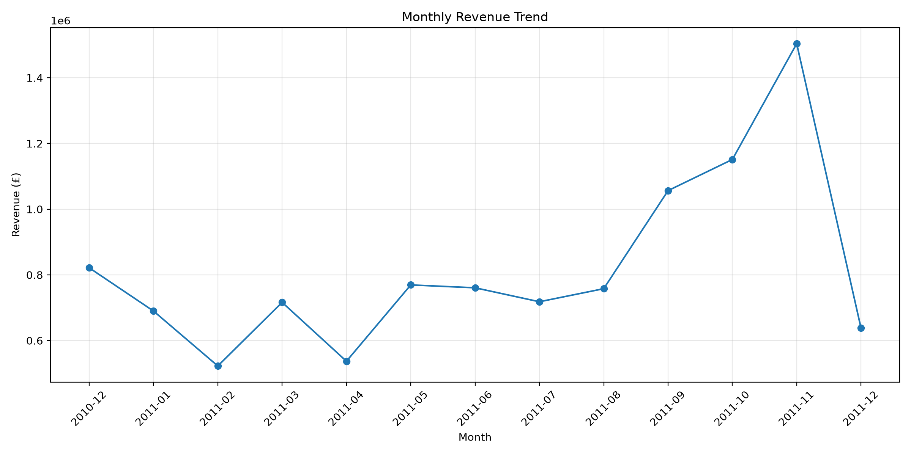
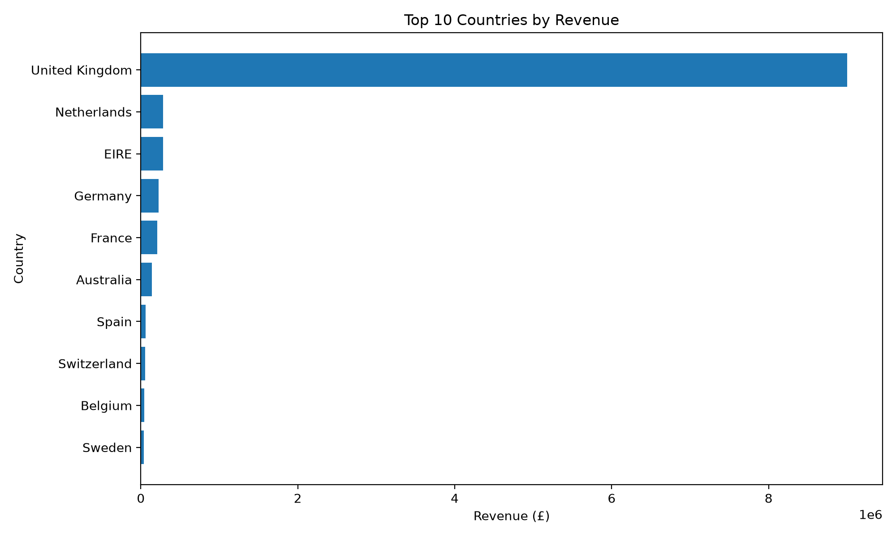
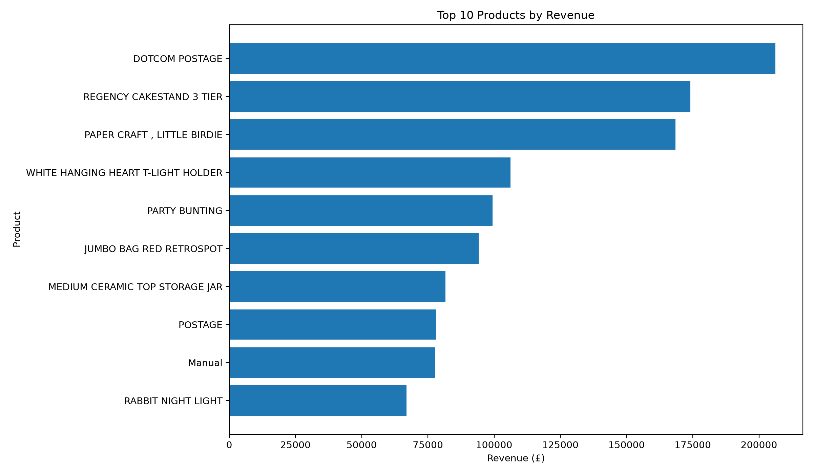

**# Online Retail Sales Analysis Using PySpark**

**## Project Overview**

**This project analyzes an online retail transaction dataset using Apache Spark (PySpark). It covers data cleaning, revenue calculation, product and country performance, and monthly sales trends.**

**## Technologies Used**

**- Python**

**- Apache Spark (PySpark)**

**- Spark SQL DataFrame API**

**- CSV dataset**

**## Dataset**

**Online Retail dataset from Kaggle:**  

**https://www.kaggle.com/datasets/vijayuv/onlineretail**

**The dataset contains transaction details such as invoice numbers, product descriptions, quantities, invoice dates, unit prices, customer IDs, and countries.**

**## Project Workflow**

**1. Loaded the retail transaction CSV into a Spark DataFrame.**

**2. Checked missing values and duplicate records.**

**3. Converted invoice dates to timestamps.**

**4. Removed duplicate records and invalid sales rows.**

**5. Calculated revenue as Quantity × UnitPrice.**

**6. Identified top products and countries by revenue.**

**7. Analyzed monthly revenue trends.**

**8. Exported the analysis results to CSV files.**

**## Key Results**

**- Original records: 541,909**

**- Records after cleaning: 524,878**

**- Duplicate records removed: 5,268**

**- Total revenue: approximately 10.64 million in dataset currency**

**- Distinct invoice numbers: 19,960**

**- Unique customers with recorded IDs: 4,338**

**- Highest-revenue country: United Kingdom**

**- Highest-revenue month in the analyzed period: November 2011**

## Data Visualizations

### 1. Monthly Revenue Trend
This line chart illustrates monthly revenue over the dataset period and highlights changes in sales performance.

### 2. Top 10 Countries by Revenue
This chart compares revenue across the ten highest-performing countries. The United Kingdom contributes the largest share of recorded revenue.

### 3. Top 10 Products by Revenue
This chart compares the top ten product descriptions by revenue. Some entries, such as postage and manual transactions, may represent charges or non-standard entries rather than ordinary products.

## Project Outputs

The `output` directory generated locally contains CSV results for:
- Overall sales summary
- Top products by revenue
- Top countries by revenue
- Monthly sales trends

The visualizations are available as PNG files in this repository.

## Skills Demonstrated
- PySpark DataFrame operations
- Data cleaning and duplicate removal
- Date and timestamp conversion
- Revenue calculation and aggregation
- Grouping, sorting, and sales trend analysis
- Data visualization with Matplotlib
- Exporting analysis results to CSV
- Project documentation with Markdown

**## Output Files**

**The `output` directory contains:**

**- `overall\_summary`**

**- `top\_products`**

**- `top\_countries`**

**- `monthly\_sales`**

**Each directory contains a Spark-generated CSV part file.**

**## How to Run**

**1. Install a compatible Java version and Python.**

**2. Install PySpark:**

&#x20;  **`python -m pip install pyspark`**

**3. Place `OnlineRetail.csv` in the project directory.**

**4. Run:**

&#x20;  **`python retail\_analysis.py`**

**## Notes and Limitations**

**- Rows with missing descriptions, invalid dates, non-positive quantities, or non-positive prices were excluded.**

**- Missing customer IDs were retained, so customer counts include only records with identifiable customer IDs.**

**- Excluding non-positive quantities may omit returns or cancellations from the analysis.**

**- The revenue metric is based on transaction quantity multiplied by unit price and should be interpreted as sales value, not necessarily accounting profit.**

**## Author**

**Aman Kumar Dubey.**

